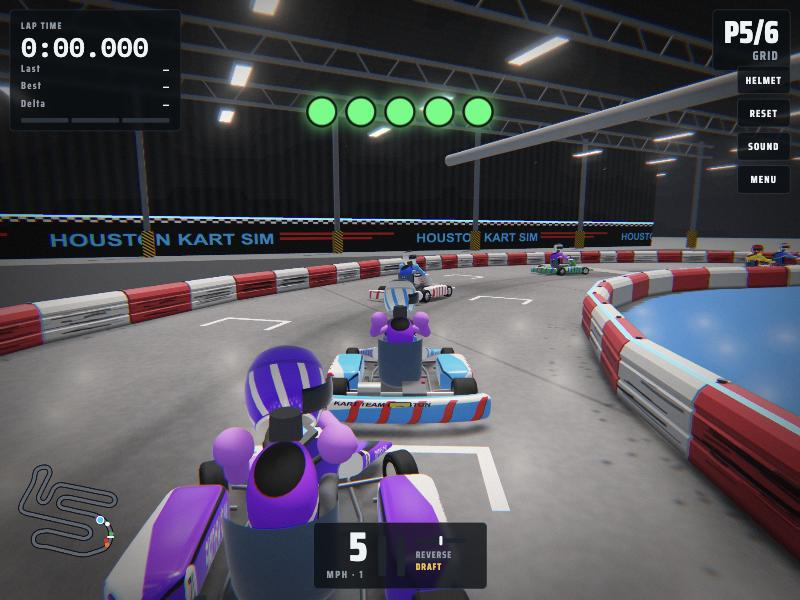

# Houston Kart Sim

An indoor kart racing simulator for Windows and macOS: realistic kart physics, AI racers with an adjustable skill slider, a helmet cam, V10 / V8 / V6-turbo engine sounds, a worldwide lap-time leaderboard and live online races against other players.



## Install

**Windows:** open PowerShell and run:

```powershell
irm https://raw.githubusercontent.com/4d1t-Codezz/houston-kart-sim/main/install.ps1 | iex
```

**Mac:** open Terminal and run:

```bash
curl -fsSL https://raw.githubusercontent.com/4d1t-Codezz/houston-kart-sim/main/install.sh | bash
```

Each installer downloads the latest release, installs it, and starts the game. Run the same line again to update.

Prefer to download by hand? Grab the latest build from the [Releases page](https://github.com/4d1t-Codezz/houston-kart-sim/releases/latest):

- **Windows:** `Houston-Kart-Sim-Setup.exe`. Windows may show "Windows protected your PC" because the app isn't code-signed; click **More info → Run anyway**.
- **Mac:** `Houston-Kart-Sim-mac-arm64.dmg` (Apple Silicon) or `-x64.dmg` (Intel). The app isn't notarized, so the first time, right-click it and choose **Open**, or allow it under **System Settings → Privacy & Security**.

## Controls

| Action | Keys |
| --- | --- |
| Throttle / brake (hold brake at a stop to reverse) | W / S or ↑ / ↓ (Space also brakes) |
| Steer | A / D or ← / → |
| Look left / right | Q / E |
| Camera (helmet, chase, TV) | C |
| Restart from the grid | T |
| Marshal reset | R |
| Sound on/off | M |
| Menu | Esc |
| Fullscreen | F11 (Windows) · Ctrl+Cmd+F (Mac) |

A gamepad works too: right trigger throttle, left trigger brake, left stick steer.

## Online play

- **World leaderboard:** enter a driver name in the menu; your best laps are posted automatically, and the menu shows the top 10 for your kart class.
- **Online races:** choose **Online race**, then **Quick race** (everyone in the public lobby), **New room** (share the 6-letter code with friends) or **Join** a code. The first driver in the room is the host and starts the race. Up to 6 drivers, 5 laps.

Online features use a free [Supabase](https://supabase.com) project. To run your own backend: create a project, paste [`docs/supabase-setup.sql`](docs/supabase-setup.sql) into its SQL editor, then add two repository secrets, `HKS_SUPABASE_URL` (the project URL) and `HKS_SUPABASE_KEY` (the publishable/anon key), and push a new version tag. Without them the game still works fully offline.

## Build from source

```bash
npm install
npm start              # run the game
npm run dist:mac       # Mac .dmg/.zip in dist/
npm run dist:win       # Windows installer in dist/
```

Releases are built by GitHub Actions whenever a tag like `v1.0.1` is pushed.

## About

Unofficial fan project, not affiliated with or endorsed by any karting company. The layout is traced from a publicly posted track map, so corner radii are approximate. Code is MIT licensed.
